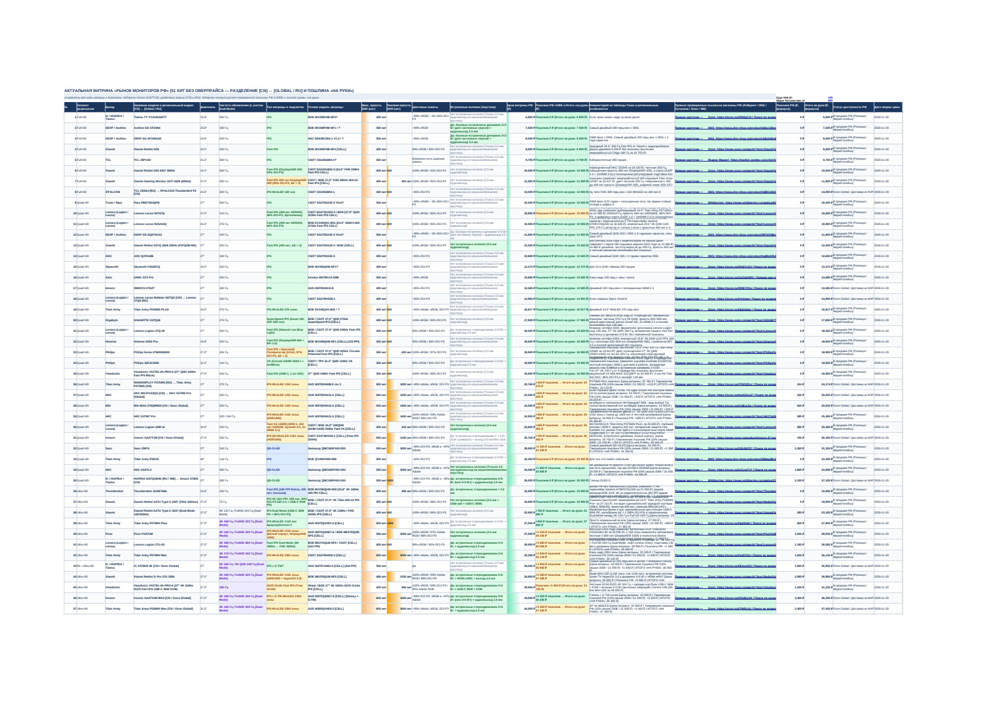
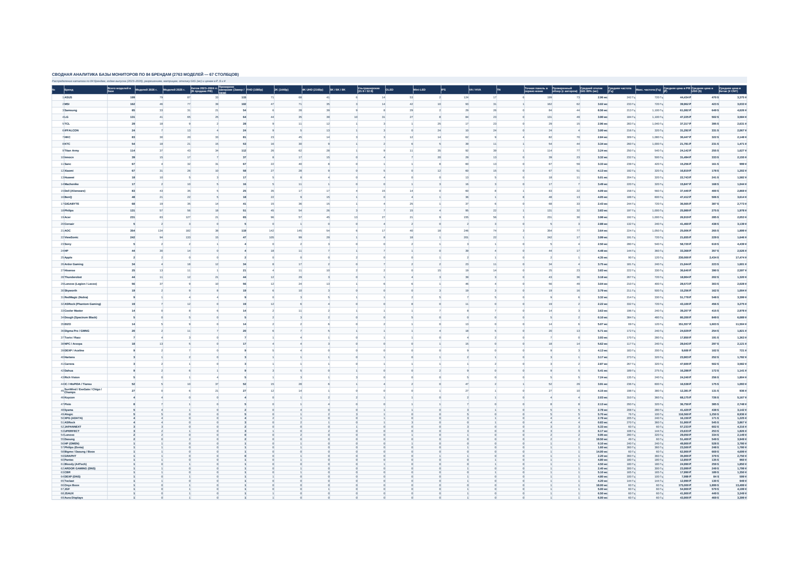

# 🖥️ monitor_full_database — Инженерная база мониторов


> 🌐 **[Открыть онлайн веб-портал (без скачивания)](https://tapocket.github.io/monitor_full_database/)** • 🤖 **[Telegram-бот @monitor_fdb_bot](https://t.me/monitor_fdb_bot)** • 📡 **[JSON API](https://tapocket.github.io/monitor_full_database/api/v1/monitors.json)**

Открытая инженерная база мониторов (**2 763 модели**, **84 бренда**) с единым источником истины (`database_master.json`), книгой Excel на **18 вкладок (69 столбцов)**, плоской выгрузкой CSV (32 столбца), автономным веб-порталом (`monitor_full_database.html`), **Тест-Лабораторией на 46 стендов** (включая реальный HDR-тест и Экспресс-мастер приёмки в ПВЗ), автоматическим CI/CD на GitHub Actions и Telegram-ботом подбора.

---

## ✨ Главные возможности

* **Полная инженерная декомпозиция (69 столбцов)**: реальная модель матрицы `[CELL / LCM]`, OEM-завод и клоны, субпиксельная структура и PPI, окна яркости HDR (`2% / 10% / 100% APL` + цветовая яркость RGB), Input Lag с FALD, VRR Flicker и рецепты CRU, аудит `sRGB Clamp`, USB-C PD и KVM.
* **Раздельные цены российского рынка и живая пошлина**: отдельные числовые столбцы **«Розница РФ (DNS / Ситилинк / Регард / ОнлайнТрейд)»** и **«Маркетплейсы / Ozon Global на руки»**, автоматическая формула расчёта пошлины РФ (`15%` свыше `200 €`), ежедневное обновление курсов ЦБ РФ (`scripts/update_cbr_rates.py`) и накладываемый снимок актуальных цен (`data/prices_rf_snapshot.json`).
* **Автономный веб-портал (`monitor_full_database.html`, ~5,7 МБ)**:
  * Мгновенный поиск, выпадающие мультиселекты, сравнение до 4 мониторов в лоб, 6-осевой инженерный радар, калькуляторы TCO, FOV°, FPS и калибровки Windows 11 HDR.
  * Словарное сжатие каталога (~4,3× меньше исходного JSON), встроенный офлайн-CSS фоллбэк и PWA (`manifest.webmanifest`, `sw.js`) — работает даже без интернета в ПВЗ.
* **Встроенная Тест-Лаборатория (46 стендов + Экспресс-мастер ПВЗ)**:
  * Полноэкранный пошаговый **«Экспресс-мастер приёмки в ПВЗ за 3 минуты»** (битые пиксели, 5% Grey Banding, равномерность белого, Ghosting, живой замер Гц с предупреждением о 60 Гц и финальный чек-лист).
  * **Стенд №46 — Реальный тест HDR (`dynamic-range: high`)**: проверка поддержки HDR/P3/Rec.2020 в браузере, окна APL (`2% / 10% / 25% / 50% / 100%`) на абсолютном чёрном фоне и градиент клиппинга PQ EOTF.
  * Группировка по 4 категориям (`Приёмка ПВЗ`, `Отклик и Гц`, `Цвет и HDR`, `Шрифты и OLED`) и живой поиск по всем стендам.
* **Экосистема сообщества и Telegram-бот**: готовые шаблоны GitHub Issues для приёма ревизий матриц из сервис-меню и цен РФ, каталог эталонных пресетов OSD / калибровки (`data/icc_profiles.json`), автодеплой GitHub Pages + статический JSON API (`/api/v1/monitors.json`) и готовый бот (`bot/telegram_bot.py`).

---

## 📸 Скриншоты

### Витрина «Рынок мониторов РФ» с живым расчётом пошлины


### Единый справочник тестов экранов и встроенной Тест-Лаборатории


### Инженерная книга Excel — Путеводитель и Сводная по 84 брендам




---

## 📂 Структура репозитория

| Файл / Папка | Назначение |
| :--- | :--- |
| `database_master.json` | Единый источник истины (Single Source of Truth) — 2 763 модели и все справочники |
| `build_database.py` | Детерминированный сборщик и автовалидатор `.csv`, `.xlsx` и `.html` |
| `monitor_full_database.xlsx` | Инженерная книга Excel (18 вкладок, 69 столбцов, живые формулы, 0 ошибок) |
| `monitor_full_database.html` | Автономный интерактивный веб-портал (5,7 МБ, офлайн-режим, 46 тест-стендов) |
| `monitor_full_database.csv` | Плоская таблица каталога (2 763 строки, 32 столбца, UTF-8 BOM) |
| `data/prices_rf_snapshot.json` | Снимок актуальных цен РФ (DNS, Ситилинк, Я.Маркет, Ozon) для живого оверлея |
| `data/icc_profiles.json` | Эталонные пресеты OSD и калибровки по индексам матриц `[CELL]` |
| `scripts/update_cbr_rates.py` | Автообновление курсов `EUR/USD/CNY` из XML API ЦБ РФ в `config/rates.json` |
| `scripts/check_links.py` | Многопоточный Link Checker (проверяет ссылки без удаления) |
| `bot/telegram_bot.py` | Telegram-бот подбора мониторов (`/find`, `/model`, `/pvz`) |
| `schema/monitor.schema.json` | JSON Schema для автоматической проверки всех полей и диапазонов |
| `config/rates.json` | Конфиг курсов валют и порога таможенной пошлины РФ (`200 €`, `15%`) |
| `manifest.webmanifest` / `sw.js` | PWA-манифест и Service Worker для офлайн-установки на смартфон |
| `.github/workflows/` | CI/CD: сборка + валидация, ежедневный курс ЦБ РФ + Link Check, деплой GitHub Pages |
| `.github/ISSUE_TEMPLATE/` | Формы сообщества для ревизий матриц `[CELL]` и обновлений цен РФ |

---

## 🚀 Быстрый старт

### 1. Использование без установки
* **Веб-портал**: откройте `monitor_full_database.html` локально в браузере или включите **GitHub Pages** (`Settings → Pages → Source: GitHub Actions`) — сайт и JSON API (`/api/v1/monitors.json`) опубликуются автоматически.
* **Таблица Excel / Google Sheets**: откройте `monitor_full_database.xlsx` локально или импортируйте в Google Таблицы (`Файл → Импортировать → Загрузка`).

### 2. Локальная пересборка и проверка целостности
```bash
pip install openpyxl jsonschema

python3 scripts/update_cbr_rates.py --config config/rates.json
python3 build_database.py \
  --master database_master.json \
  --template-xlsx monitor_full_database.xlsx \
  --template-html monitor_full_database.html \
  --outdir dist \
  --recalc --verify
```

### 3. Запуск Telegram-бота подбора
```bash
pip install -r bot/requirements.txt
export TELEGRAM_BOT_TOKEN="ваш_токен_от_BotFather"
python3 bot/telegram_bot.py

# Или запуск в Docker на VPS:
cd bot && TELEGRAM_BOT_TOKEN="ваш_токен" docker compose up -d
```

### 4. Сборка минифицированного Tailwind CSS без CDN
```bash
npm install && npm run build:css
```

---

## 🤝 Как помочь проекту

Нашли новую ревизию матрицы в сервисном меню или свежую цену в DNS / Ситилинк / Регард / ОнлайнТрейд / Ozon / WB? Создайте **Issue** через встроенные формы репозитория или откройте **Pull Request** с правкой в `database_master.json` — GitHub Actions автоматически проверит схему, пересчитает формулы Excel и опубликует обновление.
