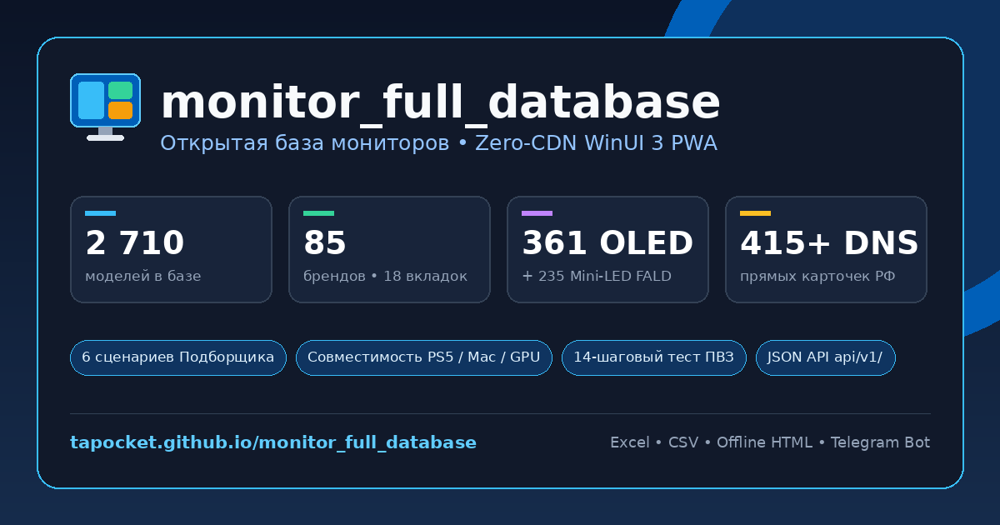
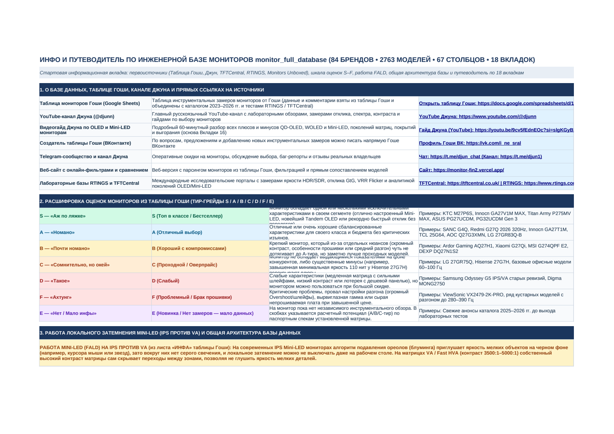
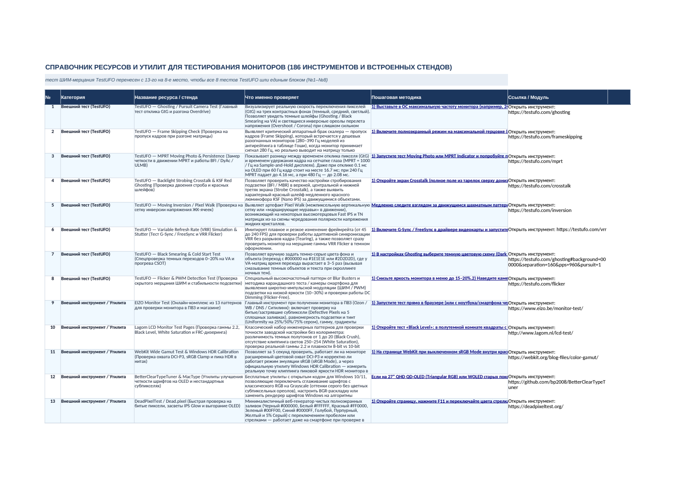

# 🖥️ monitor_full_database


Открытая инженерная база мониторов (**2 710 моделей**, **85 брендов**, 361 OLED, 235 Mini-LED) с единым источником истины (`database_master.json`), книгой Excel на **18 вкладок** (0 ошибок формул), плоской выгрузкой CSV (**30 столбцов**), полностью автономным веб-порталом в стиле **WinUI 3 / Fluent Design 2** (Zero-CDN), статическим **JSON API (`api/v1/`)**, **Тест-Лабораторией и Режимом ПВЗ**, CI/CD на GitHub Actions и **Telegram-ботом** подбора.

🌐 **Живой портал (GitHub Pages):** https://tapocket.github.io/monitor_full_database/


## 📸 Скриншоты



| Обзор каталога (Excel — 18 вкладок) | Витрина «Рынок РФ» |
| :---: | :---: |
|  |  |

| Сводная аналитика по 85 брендам | Тесты и проверка экрана |
| :---: | :---: |
|  |  |

## ✨ Главные возможности портала

* **Zero-CDN WinUI 3 (Dark / Light Mica) + Dual-Mode сборка:**
  * Быстрая веб-версия (`index.html` + `data/db_payload.js`) и единый автономный офлайн-файл (`monitor_full_database.html`) без внешних CDN и шрифтов.
  * Переключатель **Упрощённый / Полный режим**, полная адаптация под ПК и смартфон, кэширование PWA (`sw.js`).
* **Умный каталог, поиск и выгрузка:**
  * Поиск с пониманием кириллических синонимов (`асус`, `ксиаоми`, `олед`, `минилед`, `ультраширик`, `2к`, `4к`) и автокоррекцией раскладки (`фыгы щдув` → `asus oled`).
  * Виджет **«📉 Топ скидок и выгодных цен РФ»** (по `data/price_history/`), встроенный **калькулятор пошлины и курса EUR** (пересчёт порога 200 € / 100 € / 50 € / 0 € в реальном времени по всей таблице) и экспорт текущей отфильтрованной подборки в **Excel-совместимый CSV (UTF-8 BOM)**.
* **Подборщик и Сравнение в лоб:**
  * **6 быстрых 1-кликовых сценариев** (Киберспорт 24–25″ 360+ Гц, 4K OLED для ПК/PS5/Xbox, Текст и код 4K/5K, Mini-LED до 35к, Ультраширик 34″, Универсальный 27″ QHD 240+ Гц).
  * Вкладка «Сравнение» с фильтром **«Только различающиеся параметры»**, визуальным симулятором диагоналей в сантиметрах и **автоматическим инженерным вердиктом** по 5 метрикам (цена, Гц, GtG, контраст, HDR).
* **Карточка монитора:**
  * Расчёт итоговой цены «на руки» + пошлины + рисков ПВЗ, кнопка **«🖨️ Шпаргалка ПВЗ (Печать / PDF)»** на 1 лист A4.
  * Инженерный аккордеон (5 инструментов): **Совместимость PS5 / Xbox / MacBook / RTX & RX**, SVG-график истории цен, калибровка ICC/OSD/Win11 HDR, расчёт расстояния/PPI/Retina и калькулятор кабеля DP 1.4/2.1/HDMI 2.1 + DSC.
  * Автоподбор **похожих аналогов** (дешевле или с гарантией РФ) с переходом в сравнение в 1 клик.
* **Тест-Лаборатория и Режим ПВЗ (`#test=pvz`, `#test=guided`):**
  * 14-шаговый тест экрана (битые пиксели, 5% Grey OLED, FALD, 3× HiDPI, осциллограф Frame-Time), мобильный чек-лист приёмки и база сервисных меню для 47 брендов.
  * Прямые карточки магазинов РФ: **415+ прямых карточек DNS** (`/product/`), Ситилинк, Регард, ОнлайнТрейд, Ozon, Яндекс Маркет и AliExpress.

## 📡 Публичный статический JSON API (`api/v1/`)

После каждого обновления на GitHub Pages доступны лёгкие статические JSON-срезы (без авторизации и лимитов):

| Эндпоинт | Назначение |
| :--- | :--- |
| `api/v1/summary.json` | Сводка: дата обновления, число моделей/брендов, счётчики OLED/Mini-LED/LCD, список эндпоинтов |
| `api/v1/oled.json` | Компактный каталог всех **361 OLED**-моделей |
| `api/v1/miniled.json` | Компактный каталог всех **235 Mini-LED**-моделей |
| `api/v1/market_rf.json` | Витрина **«Рынок РФ»** (53 модели) |
| `api/v1/flagships.json` | Витрина **«Флагманы»** (41 модель) |
| `api/v1/brands.json` | Список всех **85 брендов** |
| `api/v1/monitors.json` | Полный каталог всех 2 710 моделей |

**Пример в JavaScript / Discord-боте:**
```js
const res = await fetch("https://tapocket.github.io/monitor_full_database/api/v1/summary.json");
const stats = await res.json();
console.log(stats.total_models, stats.counts.oled);
```

**Пример в Python:**
```python
import urllib.request, json
url = "https://tapocket.github.io/monitor_full_database/api/v1/oled.json"
oleds = json.loads(urllib.request.urlopen(url).read().decode("utf-8"))
print(f"OLED в базе: {len(oleds)}")
```

## 🤖 Telegram-бот (`bot/telegram_bot.py`)

* Пошаговый кнопочный подбор и команды: `/find`, `/oled [бюджет]`, `/miniled [бюджет]`, `/drops` (скидки РФ по истории цен), `/digest` (еженедельный дайджест новинок и скидок), `/model`, `/compare A vs B`, `/pvz <бренд>` (сервисные меню 47 брендов), `/alert`, `/myalerts`, `/delalert`.
* **Inline-режим** (`@имя_бота <модель>`): отправка карточек мониторов в любые чаты Telegram с кнопками портала, ПВЗ и магазинов.
* Автоматическая загрузка токена из локального `bot/.env` (`TELEGRAM_BOT_TOKEN=...`, файл исключён из Git).

## 🛠️ Сборка и проверка

```bash
# Полная пересборка CSV, XLSX (с пересчётом формул LibreOffice), HTML (standalone + split) и api/v1/
python3 build_database.py \
  --master database_master.json \
  --template-xlsx monitor_full_database.xlsx \
  --template-html monitor_full_database.html \
  --outdir . \
  --recalc --verify

# Полная преддеплойная проверка (py_compile, схема stores, Node DOM smoke-тесты обоих режимов)
python3 scripts/pre_deploy_check.py
```

## ⚙️ Автоматизация (GitHub Actions)

* `.github/workflows/build-and-verify.yml` — проверка схемы, `py_compile`, сборка `--recalc --verify` и прогон `scripts/smoke_test_portal.js` на каждом push/PR.
* `.github/workflows/daily-rates-and-links.yml` — **ежедневное** (раз в сутки) обновление курсов ЦБ РФ, запись истории цен, аудит 120 ссылок магазинов и обзоров (`data/LINK_AUDIT_REPORT.md`), генерация чеклиста `data/DAILY_UPDATE_CHECKLIST.md`, пересборка портала + `api/v1/` и обновление кэша `sw.js`.
* `.github/workflows/deploy-pages.yml` — автоматический деплой портала и `api/v1/` на GitHub Pages.
